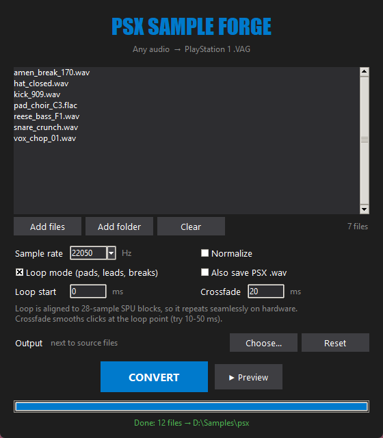

<div align="center">

# 🎮 PSX Sample Forge

**Make your samples sound like a real PlayStation 1.**
Drop any audio in, get a hardware-ready `.vag` (and a PS1-crunched `.wav` for your DAW) out.

[](https://github.com/satifiedx/PSX-auto/releases/latest)
[](https://github.com/satifiedx/PSX-auto/releases)
[](https://github.com/satifiedx/PSX-auto/stargazers)


[**⬇ Download PSX-auto.exe**](https://github.com/satifiedx/PSX-auto/releases/latest) · [English](#english) · [Русский](#русский)



</div>

Built after the video [**«Как сделать звук как на настоящей PS1»**](https://www.youtube.com/watch?v=-MQzyJTVzR0): everything it shows by hand in the command line, done in one click. For Elder Brother Core, jungle, breakcore, PS1-style game soundtracks and anyone chasing that SPU crunch.

---

## English

### What it does
* **Real PS1 sound.** Encodes to genuine SPU-ADPCM via [psxavenc](https://github.com/WonderfulToolchain/psxavenc), the same 4-bit compression the console uses.
* **PSX `.wav` export.** Decodes the `.vag` back exactly like the SPU does, so you can drop the crunched sound straight into FL Studio / Ableton / Reaper. No emulator needed.
* **▶ Preview.** Hear the PS1 version before converting. Loops are previewed looping.
* **Seamless loops.** Loop length and loop start are snapped to 28-sample SPU blocks, the loop flags are written with block precision.
* **Loop crossfade.** Built-in equal-power crossfade kills clicks at the loop point.
* **Loop start point.** Keep the attack, loop only the sustain (classic sampler style).
* **Batch.** Drag & drop files or whole folders onto the window (or onto the `.exe`).
* **Any sample rate.** 44100 (SPU max) down to 8000 Hz for extra grit. 22050 by default.
* **Any input.** WAV, FLAC, OGG, Opus, MP3, AIFF and more. Stereo is downmixed to mono.
* **Light and portable.** One `.exe`, no install, settings are remembered.

### Quick start
1. [Download](https://github.com/satifiedx/PSX-auto/releases/latest) `PSX-auto.exe` and run it.
2. Drop your samples onto the window.
3. Pick a mode:
   * **One-shot** (loop off): kicks, snares, hats, SFX.
   * **Loop mode**: pads, leads, breaks, textures. Set **Crossfade** to 10-50 ms if the loop clicks.
4. Tick **Also save PSX .wav** if you want the crunched sound in your DAW.
5. Hit **CONVERT**. Files land next to the source (or in the folder you chose).

> Windows SmartScreen may warn about an unsigned app. Click *More info → Run anyway*.

### Command line
Works from source on any OS where `psxavenc` is available:

```bash
python main.py drums/ pad.flac --loop --xfade 20 --wav -r 22050 -o out/
```

| Option | Meaning |
|---|---|
| `-r, --rate HZ` | sample rate (default 22050, max 44100) |
| `-l, --loop` | loop mode |
| `--loop-start MS` | loop start point in ms |
| `--xfade MS` | loop crossfade in ms |
| `-n, --normalize` | peak normalize to -0.3 dBFS |
| `-w, --wav` | also save the decoded `.psx.wav` |
| `-o, --output DIR` | output folder |
| `--gui` | open the window with these files |

### How it works
1. Read audio, downmix to mono.
2. Resample with [soxr](https://github.com/dofuuz/python-soxr) (VHQ). Unlike FFT resampling there is no ringing at the edges, so drum transients stay clean.
3. Loop mode: snap the loop start to a 28-sample block, trim the end so the loop is a whole number of blocks, apply the crossfade.
4. Encode with psxavenc, padding only to one 16-byte ADPCM block.
5. Write the loop-start flag into the exact block and the sample name into the VAG header.
6. Optional: decode SPU-ADPCM back to 16-bit WAV.

---

## Русский

### Что умеет
* **Настоящий звук PS1.** Кодирует в SPU-ADPCM через [psxavenc](https://github.com/WonderfulToolchain/psxavenc), то самое 4-битное сжатие, что и в консоли.
* **Экспорт PSX `.wav`.** Декодирует `.vag` обратно так же, как это делает SPU. Хрустящий звук сразу кидаешь в FL Studio / Ableton, без эмулятора.
* **▶ Предпрослушка.** Слушаешь PS1-версию до конвертации. Лупы играют зацикленно.
* **Бесшовные лупы.** Длина и старт лупа выравниваются по блокам SPU (28 сэмплов), флаги лупа ставятся точно в нужный блок.
* **Кроссфейд лупа.** Встроенный кроссфейд убирает щелчки на стыке.
* **Точка старта лупа.** Атака играет один раз, зацикливается только сустейн.
* **Пачкой.** Перетаскивай файлы или целые папки в окно (или прямо на `.exe`).
* **Любая частота.** От 44100 (максимум SPU) до 8000 Гц для лютого лоу-фая. По умолчанию 22050.
* **Любой формат.** WAV, FLAC, OGG, Opus, MP3, AIFF и т.д. Стерео сводится в моно.
* **Лёгкий и портативный.** Один `.exe`, без установки, настройки запоминаются.

### Как пользоваться
1. [Скачай](https://github.com/satifiedx/PSX-auto/releases/latest) `PSX-auto.exe` и запусти.
2. Перетащи сэмплы в окно.
3. Выбери режим:
   * **One-shot** (луп выключен): бочки, снейры, хэты, эффекты.
   * **Loop mode**: пэды, лиды, брейки, текстуры. Если луп щёлкает, поставь **Crossfade** 10-50 мс.
4. Поставь **Also save PSX .wav**, если нужен хрустящий звук для DAW.
5. Жми **CONVERT**. Файлы появятся рядом с исходниками (или в выбранной папке).

> SmartScreen может ругаться на неподписанное приложение. Жми *Подробнее → Выполнить в любом случае*.

### Командная строка
```bash
python main.py drums/ pad.flac --loop --xfade 20 --wav -r 22050 -o out/
```
Все опции: `python main.py --help` (таблица выше в английской части).

---

## 🛠 Build from source / Сборка

```bash
pip install -r requirements.txt
python main.py
```

Build the exe (or just run `build.bat`):

```bash
pyinstaller --noconfirm --onefile --noconsole --name PSX-auto --add-data "bin;bin" main.py
```

Pushing a `v*` tag builds the exe on GitHub Actions and attaches it to the release.

## Credits
* Inspired by the video [«Как сделать звук как на настоящей PS1»](https://www.youtube.com/watch?v=-MQzyJTVzR0).
* Encoding by [psxavenc](https://github.com/WonderfulToolchain/psxavenc) (WonderfulToolchain).
* Built with Python, NumPy, soundfile, soxr and Tkinter.

If this saved you some time, drop a ⭐. It helps other producers find the tool.
